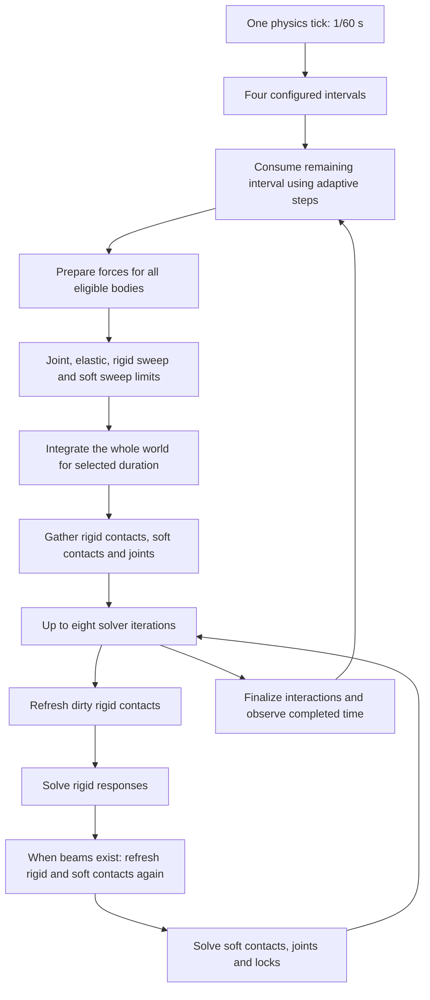

# Milestone 12 Goal 9 — Global physics algorithm audit

**Complete for review.** This report records isolated diagnostics, not an
adopted optimization. Production physics code, APIs, ownership, solver settings
and defaults are unchanged. The user selected **keeping particle–particle sweep
protection** after reviewing the blanket-exclusion experiment. Future runtime
candidates are limited to **60 Hz physics and below**; higher-rate measurements
remain historical evidence.

The [investigation plan](physics_algorithm_audit_plan.md) defines six steps and
five problem records. [NEXT_STEPS.md](../NEXT_STEPS.md#12-real-time-physics-pipeline-rework)
remains authoritative. Proposed implementation goals below are options for later
selection, not additions or automatic changes to the milestone order.

**Subsequent roadmap decision:** the user inserted
[Goal 10](physics_bottleneck_investigation_plan.md) to investigate each ranked
question and its potential solutions before implementation. It is planned,
not started. Forward references below use the renumbered implementation Goals
11–17. Goal 9's archived report and evidence retain their original numbering;
the new investigation does not imply that any proposed solution is adopted.

## Questions ranked by likely contribution

The user requested that the questions be ordered by likely culprit. This is
an evidence-based investigation ranking, not a claim that their savings add,
nor an approved implementation order. The highest-cost leaf function can be
a symptom of the loops that call it.

| Rank | Question | Evidence and confidence | Workload emphasis |
| --- | --- | --- | --- |
| 1 | Why does contact discovery repeat inside solving? | Measured inclusive rigid gathering costs about 14.46 s in the pit and 20.63 s in the car prefix; soft gathering adds about 13.14 s in the car. Only 1.226% / 0.251% of new rigid records arise after initial gathering. Repeated scans are proven; safely removable work still needs a candidate/geometry validity proof | High priority in both |
| 2 | Which adaptive restrictions multiply world work? | Measured 4,927 / 25,221 actual steps versus 2,880 / 2,400 configured intervals. The car has a 0.804 ms elastic cap and concentrated soft-sweep restrictions. The mechanics and causes are proven; replacing a limiter may expose a different one | Especially the car; also impact spikes in the pit |
| 3 | Are response passes and overlap refresh still doing useful work? | All eight iterations execute, with no early exits. Particle response is 13.66 s / 9.42 s; the dense particle path lacks the block solver's convergence result. This proves missing convergence coverage, not that fewer passes will meet the error checks | Promote ahead of adaptive policy work when focusing on sustained pit cost |
| 4 | How much work belongs to bodies unrelated to the limiting interaction? | A separated fast pair adds a global step for 200 distant bodies. Actual safely separable work in the car/pile has not been measured, and dynamic contact chains can connect much of a pile | Potentially large, but lower confidence than measured repetition |
| 5 | Are candidate growth, memory layout or dispatch the limiting factor? | Broadphase/filtering costs are measured; count/density experiments do not justify an all-pairs diagnosis. Large generic records suggest a layout test, but no cache/bandwidth bottleneck is established. Circle-gather geometry is already a small SIMD-batched fraction | Profile memory/branches before selecting storage or hardware changes |

## Additional hypotheses and disproof tests

These refine the five questions after the user's request for deeper alternatives.
They are **untested follow-up hypotheses**, except for the explicitly measured
observations. They neither relax the review limits nor start a new goal.

| Area | Hypothesis | Test that can confirm or refute it | Consequence and tradeoff |
| --- | --- | --- | --- |
| Repeated discovery | Most correction invalidations are broader than the actual changed geometry | Associate each correction with affected bodies/pairs, then compare exact refresh against a conservative cached candidate set with bounds-expansion fallback | A changed-pose worklist can remove scans; a candidate cache can remove queries. Both need topology/filter/lifetime invalidation and correction-created-contact coverage |
| Adaptive restrictions | Some restrictions are conservative substitutes for actual collision risk, or sweep geometry and response geometry do not resolve the same pair | For the worst repeated beam pair, record proxy geometry, entry/existing-contact branch, gap, closing motion, acceleration bound, discrete contact result and post-response motion for every microstep. Check actual advancement and any margin/precision mismatch | May identify a localized bound or response defect with greater value than faster pair math. Do not assume tiny steps are needless or raise the minimum step without a crossing proof |
| Adaptive restrictions | The current spring integrator imposes stability work that need not be global | First evaluate each selector against the same original proposal in an observation-only diagnostic; then compare local elastic integration or a different numerical formulation at unchanged authored stiffness/mass | The present sequential winner histogram cannot predict the next limiter after removal. A different formulation may introduce damping, energy or deformation changes requiring a separate design choice |
| Response/convergence | A late pass is nearly redundant, or poor ordering prevents early convergence | Record positional, normal-velocity and friction residuals plus useful corrections after each pass; compare stopping-check overhead, contact ordering and existing retained state before changing pass policy | Better convergence can save both response and downstream refresh. A 0.5 penetration review limit alone does not bound energy, rebound or support error and is not a new solver slack setting |
| Unrelated work | Static supports falsely make a proposed island graph appear globally connected | Build dynamic dependency graphs through responsive contacts, joints and beams; keep immutable static supports separate, then measure work outside the limiting component and conservative future merges | A floor may be shared without coupling independent dynamics. A dense particle chain can still form one large component; local clocks add synchronization and force-timing obligations |
| Data access | Generic record traffic and dispatch outweigh particle impulse arithmetic | Sample cache/branch/bandwidth behavior and compare compact particle records at identical solve order, including conversion and invalidation costs | SIMD benefits depend on the resulting workload. Shared-body writes still prevent naive parallel response; atomics do not preserve sequential reads or convergence |
| Across all areas | The largest spikes have a different cause from sustained cost | Correlate per-update exclusive cost with limiter identity, steps, iterations and contact churn; retain worst and p95 alongside total work | The measured tail analysis below supplies a starting point. Optimizing a cheap average path may leave the frame target unchanged |
| Across all areas | A local speedup merely moves work or increases repetitions elsewhere | Compare complete clean updates, error curves, candidate counts and actual iterations at the same workload/configuration; only combine independently understood mechanisms | Caches add maintenance, tighter broadphase layouts may increase rebuilding, and parallel/Jacobi response may require more passes. Do not add overlapping estimated savings |

## Scope, identity and evidence

- Immediate parent: `ab3c634b273ea9707494871017adb524761da1e7`, on
  `physics-pipelines`.
- Frozen reference: `physics-pipelines-overoptimized` at
  `6f283268aa4bf038c4ed78271baeb9d5986bd7d9`. No comparison with `main`.
- Goal 8 engine, fixture and example sources match the pinned parent. Its
  source manifests, installed SDKs and platform verification are reusable for
  that exact implementation and tested configuration; they do not validate a
  newly tuned configuration or prototype.
- New workload configuration: 60 Hz, four configured subdivisions, eight solver
  passes, original correction settings. Pit: 800 diameter-5 particles,
  restitution 0.5, unchanged twelve-second drop/pile. Car: unchanged scene,
  terrain, materials, 200 standalone particles and existing input script, using
  the authorized 600-update prefix. The car's float-valued tick yields
  10.000000521541 simulated seconds; this is not the full sixty-second endpoint.
- Three serial AC-powered trials establish the final workload timing summaries.
  Streaming closure is operator-confirmed; the runner records AC at both ends.
  No builds run concurrently with timings. Headless results do not establish
  rendered FPS, window-switch behavior, pacing, backlog or final acceptance.
- Hardware is the reference Intel Core Ultra 5 125H laptop, Linux x86-64.
  Final objects/consumers use GCC 15.2.0 and the pinned Release engine flags;
  compiler commands and CMake caches are retained. CPU affinity and frequency
  were not fixed. The [hardware record](../sandbox/milestone_12/goal_9/hardware.json)
  is a final identity check, not a claim of continuous frequency monitoring.
- Raw evidence, isolated source copies, installed SDKs and executables live in
  [`sandbox/milestone_12/goal_9/`](../sandbox/milestone_12/goal_9/). Earlier goals'
  artifacts remain unchanged. The [reproduction procedure](../sandbox/milestone_12/goal_9/reproduction.md),
  [evidence checks](../sandbox/milestone_12/goal_9/run_verification.json) and
  [artifact manifest](../sandbox/milestone_12/goal_9/manifest.json) identify the
  selected final runs and superseded diagnostics.

The penetration review limit remains 0.5 units for standalone particle pairs in
the pit/head-on fixture, and provisionally 0.1 for Milestone 6 extreme fixtures.
These limits do not change solver correction slack. There is no newly invented
pit-wall or car-wide numerical tolerance. Tunneling, missed response, finite
state and elapsed-time consumption remain separate checks. Endpoint overlap
alone cannot prove the absence of a complete pass-through.

## Execution hierarchy and measurement boundaries



[Pipeline orchestration](../src/physics/pipeline/physics_pipeline.c) consumes
all requested time. Reducing the outer tick rate does not remove its configured
or adaptive inner loops. At 60/4, each proposed configured interval is about
4.17 ms; smaller limits still apply.

Two timer partitions are reported independently. The existing measurement
wrapper attributes coarse stages, responses, locks and reporting. The audit
source copies instrument static broadphase helpers, refresh phases and adaptive
causes. Each stack subtracts its timed children; its exclusive sum must equal
its independently measured root. Never add the two partitions together.
Inclusive phase costs identify what a refresh contains and are not added to
child costs. Instrumented timings include their observation overhead; clean
executables establish whole-update cost.

Counters distinguish repeated work from unique pairs **within one adaptive
step**. A pair appearing in another step is counted again. Candidate hashes
include tested misses; an existing contact's pair lookup can skip another
narrowphase test. Dirty calls, unique dirty entries and changed poses measure
different events. An impulse-attempt flag is not proof that a body moved.
Adaptive records preserve the sequential selector order and ties. They do not
pretend to evaluate every selector independently against the original duration.
A rigid candidate superseded by a later soft restriction is not a final winner.
The CSV's relative-speed field is the magnitude of the stored body-velocity
difference, not closing normal speed. Its `pair_gap` uses body positions minus
particle radii; it is only a diagnostic position-based estimate, not a general
polygon separation or an offset-aware collision oracle. Actual duration choices
come from the unchanged engine geometry calculations.

The first observation build is preserved as `source/audit_v1/`,
`source/audit_v1.a` and `bin/diagnostics_v1/`. Its car overlap probe included
filtered pairs; those maxima are not physical penetration verdicts. The refined
probe filters nonresponding pairs and separates standalone particles from soft
node circles. The first coupling probe's report-derived `contact=0` was an
insufficient contact check; the refined probe uses the public contact query in
each completed-substep observer. Initial compiler/header/generator failures are
preserved in build logs; final build status is reported separately.

## Measured results

### Clean 60 Hz workload costs

Three serial runs per workload, existing sweep protection, 60/4/8. These are
physics CPU costs in headless playback, not rendered FPS acceptance. The car
column covers only the ten-second prefix.

| Workload | Total CPU ms | CPU ms / simulated s | Mean CPU / update ms | p95 CPU / update ms | p95 / 16.67 ms | Mean physics work / real time |
| --- | --- | --- | --- | --- | --- | --- |
| pit | 34465.826 | 2872.2 | 47.869 | 93.306 | 5.60× | 2.87× |
| car | 68498.759 | 6849.9 | 114.165 | 200.970 | 12.06× | 6.85× |

The ratios are necessary physics headroom, not sufficient rendered requirements.
Rendering and application work still need budget. No uncapped rendered
headroom or backlog acceptance is established.

### Every selected timing trial

`parent_clean` has no diagnostic wrappers. `audit_v2` observes causes;
`audit_response` adds response-category timers. Their extra work is not an
engine regression. Every selected run records AC at start and end.

| Trial | Total CPU ms | p95 CPU ms | Worst update CPU ms |
| --- | --- | --- | --- |
| [parent_clean_pit_60_1](../sandbox/milestone_12/goal_9/runs/parent_clean_pit_60_1/results.json) | 33353.092 | 90.611 | 277.918 |
| [parent_clean_pit_60_2](../sandbox/milestone_12/goal_9/runs/parent_clean_pit_60_2/results.json) | 34465.826 | 93.306 | 286.166 |
| [parent_clean_pit_60_3](../sandbox/milestone_12/goal_9/runs/parent_clean_pit_60_3/results.json) | 34553.022 | 93.920 | 286.627 |
| [audit_v2_pit_60_1](../sandbox/milestone_12/goal_9/runs/audit_v2_pit_60_1/results.json) | 39842.702 | 111.468 | 345.929 |
| [audit_v2_pit_60_2](../sandbox/milestone_12/goal_9/runs/audit_v2_pit_60_2/results.json) | 40059.000 | 111.829 | 346.088 |
| [audit_v2_pit_60_3](../sandbox/milestone_12/goal_9/runs/audit_v2_pit_60_3/results.json) | 39455.459 | 111.743 | 346.356 |
| [audit_response_pit_60_1](../sandbox/milestone_12/goal_9/runs/audit_response_pit_60_1/results.json) | 41534.081 | 120.422 | 377.791 |
| [audit_response_pit_60_2](../sandbox/milestone_12/goal_9/runs/audit_response_pit_60_2/results.json) | 40853.688 | 116.089 | 361.511 |
| [audit_response_pit_60_3](../sandbox/milestone_12/goal_9/runs/audit_response_pit_60_3/results.json) | 41472.119 | 120.467 | 375.833 |
| [parent_clean_car_60_1](../sandbox/milestone_12/goal_9/runs/parent_clean_car_60_1/results.json) | 70013.863 | 206.352 | 2933.600 |
| [parent_clean_car_60_2](../sandbox/milestone_12/goal_9/runs/parent_clean_car_60_2/results.json) | 68001.400 | 198.305 | 2789.304 |
| [parent_clean_car_60_3](../sandbox/milestone_12/goal_9/runs/parent_clean_car_60_3/results.json) | 68498.759 | 200.970 | 2888.818 |
| [audit_v2_car_60_1](../sandbox/milestone_12/goal_9/runs/audit_v2_car_60_1/results.json) | 76692.197 | 227.623 | 3221.709 |
| [audit_v2_car_60_2](../sandbox/milestone_12/goal_9/runs/audit_v2_car_60_2/results.json) | 76828.361 | 225.551 | 3228.262 |
| [audit_v2_car_60_3](../sandbox/milestone_12/goal_9/runs/audit_v2_car_60_3/results.json) | 76078.943 | 223.635 | 3220.899 |
| [audit_response_car_60_1](../sandbox/milestone_12/goal_9/runs/audit_response_car_60_1/results.json) | 78715.716 | 233.107 | 3343.135 |
| [audit_response_car_60_2](../sandbox/milestone_12/goal_9/runs/audit_response_car_60_2/results.json) | 78549.337 | 233.841 | 3337.245 |
| [audit_response_car_60_3](../sandbox/milestone_12/goal_9/runs/audit_response_car_60_3/results.json) | 76965.927 | 226.703 | 3273.533 |

Observed consumer-CPU overhead uses the same clock/boundary as the clean
consumer. Stage wall time is not divided by clean CPU time.

| Workload | Observation version | Median CPU ms | CPU overhead |
| --- | --- | --- | --- |
| pit | audit_v2 | 39842.702 | 15.60% |
| pit | audit_response | 41472.119 | 20.33% |
| car | audit_v2 | 76692.197 | 11.96% |
| car | audit_response | 78549.337 | 14.67% |

### Exclusive pipeline work

Arithmetic means of three instrumented runs. Each column is one nonoverlapping
partition and reconciles with its independently measured root. Counts and
state traces agree between trials and with the parent.

| Stage | Pit ms / 12 s | Pit ms / simulated s | Car ms / 10 s prefix | Car ms / simulated s |
| --- | --- | --- | --- | --- |
| orchestration | 285.057 | 23.755 | 995.787 | 99.579 |
| force_preparation | 162.186 | 13.515 | 890.699 | 89.070 |
| integration | 351.386 | 29.282 | 1921.749 | 192.175 |
| subdivision_sweeps | 5174.460 | 431.205 | 11913.898 | 1191.390 |
| contact_gathering | 14506.422 | 1208.869 | 33946.283 | 3394.628 |
| joint_gathering | 41.589 | 3.466 | 209.799 | 20.980 |
| rigid_solving | 18507.030 | 1542.252 | 21347.890 | 2134.789 |
| joint_solving | 277.632 | 23.136 | 4469.374 | 446.937 |
| soft_solving | 0.000 | 0.000 | 1270.629 | 127.063 |
| finalization | 1933.428 | 161.119 | 779.403 | 77.940 |
| reporting | 112.254 | 9.355 | 491.134 | 49.113 |

### Causes inside those stages

A separate source-instrumentation partition: **do not add this table to the
pipeline table**. All categories costing at least 1,000 ms in either workload
are shown. Response categories classify visits by stored response flag and
particle masks, including attempts that apply no impulse; soft node circles
can count as particles. `solve_iteration` is the remainder after these children,
including soft/joint/lock work. `integration` retains uninstrumented child work
such as soft sweeps, so use the coarse partition for stage ownership.

| Exclusive category | Pit ms (% source root) | Car ms (% source root) |
| --- | --- | --- |
| response_pp | 13662.041 (33.07%) | 9415.432 (12.04%) |
| soft_gather | 8.722 (0.02%) | 13137.155 (16.80%) |
| solve_iteration | 4936.169 (11.95%) | 12311.398 (15.74%) |
| broadphase_query | 8427.265 (20.40%) | 9471.038 (12.11%) |
| integration | 353.016 (0.85%) | 5475.288 (7.00%) |
| broadphase_build | 2504.546 (6.06%) | 3945.321 (5.04%) |
| sweep_query | 2615.200 (6.33%) | 3928.178 (5.02%) |
| pair_filter | 2618.095 (6.34%) | 3807.677 (4.87%) |
| response_overlap | 0.000 (0.00%) | 3022.224 (3.86%) |
| sweep_prepare | 1505.751 (3.64%) | 2769.793 (3.54%) |
| response_pr | 1909.079 (4.62%) | 2560.140 (3.27%) |
| narrow_other | 178.939 (0.43%) | 2492.943 (3.19%) |
| root | 487.301 (1.18%) | 1941.274 (2.48%) |
| sweep_pair | 1013.772 (2.45%) | 1550.382 (1.98%) |
| All smaller categories | 1091.164 | 2376.182 |

### Initial discovery versus solver refresh

These are **inclusive phase costs**; their broadphase/geometry children already
appear in the preceding tables. New records are new to the current adaptive
step, not globally unique pairs. A low discovery yield does not authorize
skipping geometry updates or losing correction-created contacts.

| Workload | Phase | Calls | Inclusive ms | Source-root share | New rigid records | Share of new rigid records |
| --- | --- | --- | --- | --- | --- | --- |
| pit | gather_initial | 4927 | 5720.906 | 13.85% | 4988167 | 98.774% |
| pit | gather_dirty | 35097 | 8743.133 | 21.16% | 61932 | 1.226% |
| pit | gather_soft | 0 | 0.000 | 0.00% | 0 | 0.000% |
| car | gather_initial | 25221 | 9022.801 | 11.54% | 4997157 | 99.749% |
| car | gather_dirty | 201462 | 5217.486 | 6.67% | 10532 | 0.210% |
| car | gather_soft | 201768 | 6393.267 | 8.18% | 2043 | 0.041% |

### Work frequencies and reuse

| Counter | Pit / 720 ticks | Car prefix / 600 ticks |
| --- | --- | --- |
| substeps | 4927 | 25221 |
| iterations | 39416 | 201768 |
| early_exit | 0 | 0 |
| dirty_calls | 123369994 | 127950846 |
| dirty_unique | 22371430 | 50506777 |
| refit_visited | 28182891 | 127017450 |
| refit_changed | 9221178 | 11717365 |
| query_visited | 32139272 | 134962065 |
| query_executed | 13177559 | 19661980 |
| pair_callbacks | 65123325 | 59901913 |
| retained_pair_skip | 20656233 | 17466538 |
| narrow_pp | 6529984 | 4121234 |
| narrow_other | 219454 | 6864446 |
| unique_candidates | 5939225 | 6096824 |
| response_pp | 38301888 | 30244260 |
| response_mixed | 1676612 | 3719018 |
| response_rr | 67744 | 700559 |
| overlap_only | 0 | 5101464 |
| manifold_hit | 730548 | 3323206 |
| manifold_miss | 1013808 | 1376913 |
| soft_scan_capacity | 5045248 | 232436736 |
| soft_beams_eligible | 0 | 18159120 |
| soft_beams_skipped | 0 | 270000 |
| soft_queries | 0 | 17889120 |
| constraint_peak | 1868 | 269 |
| constraint_bytes_peak | 2768896 | 692224 |

| Workload | Configured intervals | Actual steps | Steps / tick | Iterations / step | Rigid gathers / step |
| --- | --- | --- | --- | --- | --- |
| pit | 2880 | 4927 | 6.843 | 8.000 | 8.123 |
| car | 2400 | 25221 | 42.035 | 8.000 | 16.988 |

The particle convergence path is structurally unavailable to the dense pit;
zero early exits do not show that all eight passes are necessary. Geometry
cache hits show that caching already exists. Shape sizes are not hardware
cache-miss measurements.

### Final adaptive causes

A later restriction supersedes an earlier one. The tie column records equal
elastic and rigid bounds, not two independent added steps.

| Workload | Unchanged | Reduced | Elastic only | Rigid only | Soft sweep | Elastic + rigid tie |
| --- | --- | --- | --- | --- | --- | --- |
| pit | 2880 | 2047 | 0 | 2047 | 0 | 0 |
| car | 2400 | 22821 | 5076 | 6518 | 10080 | 1147 |

| Workload | PP accelerated candidate reductions | PP entry candidate reductions | PP existing-contact reductions | PP final winners/ties | Relative speed min/median/max | Winners below 1 unit/s |
| --- | --- | --- | --- | --- | --- | --- |
| pit | 0 | 5631 | 0 | 1974 | 0.571716 / 9.55746 / 36.3435 | 12 |
| car | 1900 | 391 | 0 | 2666 | 0.0137002 / 11.9759 / 362.853 | 372 |

Candidate reductions can replace an earlier candidate in the same search;
they must not be summed as extra steps. The car elastic cap is 0.000803705588 s
and strictly shortens 20,759 proposals before subsequent sweep decisions.
It is independent of speed. Pair identities, gaps and complete tie masks are
in each `audit_durations.csv`.

### Count and density diagnostics

Each finishes twelve seconds at 60/4/8. These are single instrumented structural
experiments, not repeated throughput claims or altered acceptance fixtures.
Scale multiplies the 240-unit wall-center separation and 180-unit wall height;
wall thickness stays 10. Usable width is `240*scale-10`, wall top is
`180*scale-5`; count/area is therefore approximate. Columns are the smaller of
`floor(40*scale)` and `floor((120*scale-7.5)/2.75)`, with unchanged 5.5 spacing,
2.75 stagger and centering rule. The second bound fits the initial circles
inside the walls; its only change is 19 rather than 20 columns for density 200.
The common 800 case is reused once and has exact state/work parity with the
unchanged pit. Final selected runs are listed in `run_selection.json`.

| Layout | Particles | Scale | Columns | Steps | Pair callbacks | Callbacks / step / particle | Narrowphase tests / unique tested pair | New records | Worst floor depth | Side escape |
| --- | --- | --- | --- | --- | --- | --- | --- | --- | --- | --- |
| fixed | 200 | 1 | 40 | 3249 | 3016794 | 4.643 | 1.008 | 826401 | 0.001198053 | 0.000000000 |
| fixed | 400 | 1 | 40 | 3719 | 14799739 | 9.949 | 1.013 | 1872913 | 0.003463268 | 0.000000000 |
| fixed | 800 | 1 | 40 | 4927 | 65123325 | 16.522 | 1.136 | 5050099 | 0.023434162 | 0.000000000 |
| fixed | 1600 | 1 | 40 | 7420 | 182637991 | 15.384 | 1.217 | 14249370 | 0.162520647 | 0.000000000 |
| density | 200 | 0.5 | 19 | 3553 | 7880429 | 11.090 | 1.049 | 915257 | 0.005483389 | 0.000000000 |
| density | 400 | 0.707106781 | 28 | 4031 | 24891413 | 15.437 | 1.074 | 2040165 | 0.010313988 | 0.000000000 |
| density | 800 | 1 | 40 | 4927 | 65123325 | 16.522 | 1.136 | 5050099 | 0.023434162 | 0.000000000 |
| density | 1600 | 1.41421356 | 56 | 6763 | 157896777 | 14.592 | 1.245 | 13304773 | 0.061570644 | 0.000000000 |

All layouts retain their full-run error and endpoint records in `summary.json`.
Earlier density runs are preserved but excluded: the 200 layout began with
wall overlap, and the printed escape distance still used the original width.
The corrected 400/1600 reruns preserve exact state/work traces; their earlier
escape-condition checks already used scaled width. All selected runs report
zero escape samples. Fixed-1600 floor depth reaches 0.162520647; no separate
hard pit-wall threshold was selected. Scaling runs do not have the independent
particle-pair penetration oracle used for the unchanged 800-particle workload.
Changing row count changes falling height and impact timing; total work growth
is not by itself proof of quadratic complexity.

### Phases, perturbation and spatial separation

Representative first-trial phase costs are diagnostic; final full-run timings
above use all three trials. Full-run maxima remain in every log. Low speed
means linear speed and absolute angular speed below 0.01 at tick boundaries;
it is an observation, not a sleeping criterion.

| Workload | Simulated interval s | Steps | Iterations | New records | Source-root ms | Low-speed body observations / all |
| --- | --- | --- | --- | --- | --- | --- |
| pit | 0.000–2.000 | 480 | 3840 | 960 | 835.005 | 0/96000 |
| pit | 2.000–5.000 | 2753 | 22024 | 2185613 | 14612.650 | 2257/144000 |
| pit | 5.000–10.000 | 1213 | 9704 | 1985167 | 18219.163 | 645/240000 |
| pit | 10.000–12.000 | 481 | 3848 | 878359 | 7888.338 | 404/96000 |
| car | 0.000–2.000 | 4388 | 35104 | 245293 | 8801.427 | 700/43200 |
| car | 2.000–5.000 | 11547 | 92376 | 2664651 | 34138.241 | 1640/64800 |
| car | 5.000–10.000 | 9286 | 74288 | 2099788 | 35894.035 | 1575/108000 |

At ten seconds, the perturbation gives the highest particle velocity (50, -20).
Its first 600 updates match the unperturbed run. The final two seconds show the
work comparison below. There is no sleeping implementation here; this supplies
a wake-propagation comparison fixture rather than validating a new wake policy.

| Diagnostic | Steps in 10–12 s | Iterations | New records | Changed poses in refits | Full-run floor depth | Full-run escape |
| --- | --- | --- | --- | --- | --- | --- |
| audit_scaling_fixed_800_60 | 481 | 3848 | 878359 | 2252179 | 0.023434162 | 0.000000000 |
| audit_perturb_800_60 | 481 | 3848 | 875697 | 2249103 | 0.023434162 | 0.000000000 |

In the separated-group probe, the fast collision adds one global substep
(120 → 121 over 0.5 s), hence 200 extra integrations of distant slow particles.
It detects contact, rebounds without crossing and has worst depth 0.000500202179.
This proves global coupling, but the small increment refutes any claim that
this fixture establishes a large island-scheduling speedup.

### Isolated policy experiments and physics errors

Per-substep, response-filtered circle observations. Car values include 100 node
circles plus 200 standalone particles; node and beam errors are reported
separately and have no newly invented car-specific acceptance threshold.
Beam error is absolute length error or error/rest-length, not penetration.
RMS is over all particle-flagged bodies, not a chassis velocity. These endpoint
samples do not prove no seam tunneling or acceptable visual car behavior.

| Run | Steps | Worst responding PP depth | Worst node-involving PP depth | Worst beam length error | Worst beam relative error | Final RMS speed |
| --- | --- | --- | --- | --- | --- | --- |
| parent_pit_60_oracle | 4927 | 0.019971246 | — | — | — | 0.403878340 |
| no_pp_pit_60_oracle | 3061 | 0.048643396 | — | — | — | 0.390384923 |
| parent_car_60_oracle_v2 | 25221 | 0.041826790 | 0.015560134 | 13.419484546 | 1.472364484 | 109.897861032 |
| no_pp_car_60_oracle_v2 | 24752 | 0.046769344 | 0.010398368 | 16.022874290 | 1.336204876 | 89.756462947 |

The blanket-exclusion pit changes worst depth 0.019971246 → 0.048643396,
with zero side escapes. Its first CPU comparison was 34,499.658 → 30,499.761 ms
(includes observation overhead); these are exploratory single runs, not a
repeatable speedup claim. Car timing varied across observation runs and its
trajectory/deformation changed. The user rejected adopting exclusion.

| Impact diagnostic | Pass cases | Fail cases | All five finish | Worst observed depth | Any crossing |
| --- | --- | --- | --- | --- | --- |
| no_pp_head_on_gcc | 4 | 1 | True | 5.48362732e-05 | True |
| entry_only_head_on_gcc | 5 | 0 | True | 0.000500202179 | False |
| parent_overlap_head_on | 5 | 0 | True | 0.000500202179 | False |
| entry_only_overlap_head_on | 0 | 5 | True | 0.0 | True |
| no_pp_overlap_head_on | 0 | 5 | True | 0.0 | True |

These dedicated impact fixtures retain one configured substep; they are
not the four-substep car/pit schedule. The original no-sweep miss is the
120 Hz fixture schedule; historical stress
schedules remain regression coverage, not proposed runtime rates. The additional
initially overlapping control starts with 0.25 units of overlap and also fails
at 30 and 60 Hz. Reported depth samples are after completed substeps, so the
parent's 0.000500202179 maximum does not include the initial 0.25 setup. Both retain the exact
2.5-second endpoint despite finite numerical failures. A zero observed depth
with a crossing is a failed collision, not perfect accuracy.

## 1. Repeated contact discovery

**What it does and why it helps.**
[The solver](../src/physics/constraints/constraint_solver.c) marks a gathered
rigid list dirty on entry. During each iteration,
[the contact stage](../src/physics/physics_step.c) refreshes dirty rigid data
before response. If any soft beams exist, it flushes changed hitboxes and
refreshes rigid and soft contacts again before soft response. Rigid corrections
can introduce a previously absent beam contact; this second refresh protects
that interaction and retains impact targets across iterations. Existing pair
lookup, unchanged-pose refits and soft-boundary caches already avoid some work.

**Why it costs.** These refreshes occur inside two larger repetition loops:
adaptive steps and solver iterations. A refit still scans the collider list to
discover changed poses. The soft gather scans beam-pool capacity, and one changed
rigid can make otherwise unchanged beams query again. Contact discovery,
geometry refresh and interaction publication are currently coupled. Broadphase
traversal and filtering can dominate even when almost no new geometry needs
solving. The measured phase and new-contact counts above distinguish required
refresh from scans that discover nothing; a large call count alone is not proof
that a refresh may safely be removed.

**Alternatives and tradeoffs.**

| Alternative | Benefit and removable work | Cost, risk and validation |
| --- | --- | --- |
| Retain current refresh | Preserves observed composition and correction-induced contact discovery | Retains measured repeated scans; appropriate fallback |
| Dirty collider worklist with incremental refits | Visits explicitly changed bodies rather than scanning every collider | Must distinguish velocity-only changes, positional correction, shape/filter/topology changes and handle reuse; preserve standalone gather behavior |
| Retain conservative candidates for an iteration group | Avoids repeating tree traversal for pairs whose reachable bounds are already covered | Needs proven bounds on solver correction, including soft/joint movement; bounds expansion or invalidation must trigger discovery, otherwise new contacts are missed |
| Refresh only affected pairs and incident beams | Avoids global soft queries after local rigid corrections | Requires adjacency, handle-safe invalidation and a policy for newly reachable pairs; can move work into maintenance |
| Delete the second soft refresh | Directly removes a visible loop | Unacceptable without an equivalent discovery guarantee; previously separated beam contacts may be missed |

Savings are bounded by the measured discovery work affected, not all solving
cost. Dirty worklists and retained candidates overlap in savings and must not be
added. Candidate maintenance, displacement bounds and cache traffic are new
costs. Preserve deterministic pair publication order unless separately accepted.
No new public API or external ownership is required in principle, but this is
an inference, not an implemented lifetime proof.

**Recommendation.** Prioritize a small internal dirty-worklist experiment, then
consider bounded candidate reuse if traversal remains dominant. Map this to
Goal 12 (shared gathering), with Goal 14 covering soft-contact consequences and
Goal 15 covering invalidation/composition. Acceptance should include measured
changed/visited ratios, total update cost, correction-created contacts, manual
stages, deletion/reuse and the retained penetration limits. These are proposed
follow-up tasks, not work adopted during this audit.

## 2. Adaptive duration restrictions

### Worst-update causes

This is a postprocessing of all three existing response-profile CSVs, not new
timing runs. It uses the source root and therefore is not interchangeable with
the clean CPU p95/max table. The slowest 5% are ranked separately within each
instrumented trial; they are not samples of clean rendered frames.

| Trial | Worst update | Simulated endpoint s | Source-root ms | Steps in update | Solver iterations | Slowest 5% share of full root |
| --- | --- | --- | --- | --- | --- | --- |
| audit_response_pit_60_1 | 202 | 3.366667 | 378.418 | 66 | 528 | 15.75% |
| audit_response_pit_60_2 | 202 | 3.366667 | 362.199 | 66 | 528 | 15.52% |
| audit_response_pit_60_3 | 202 | 3.366667 | 377.360 | 66 | 528 | 15.82% |
| audit_response_car_60_1 | 133 | 2.216667 | 3350.717 | 1442 | 11536 | 14.99% |
| audit_response_car_60_2 | 133 | 2.216667 | 3344.843 | 1442 | 11536 | 14.97% |
| audit_response_car_60_3 | 133 | 2.216667 | 3281.478 | 1442 | 11536 | 14.97% |

In every pit trial, update 202 has 66 particle-pair winning restrictions.
In every car trial, update 133 has 1,442 steps: 1,438 soft-sweep winners from
the same recorded pair `(350, 0)` plus four unchanged remainder steps. The
median selected step in that update is 3.712 microseconds, far below the
0.804 ms elastic cap. Its eight passes per step produce 11,536 iterations.
This distinguishes a concentrated collision restriction from the sustained
spring-stability limit. The pair identifiers are runtime indices in this
preserved fixture, not a proposed stable cache key.

The soft pair bound in [beam motion](../src/physics/soft_body/beam_motion.c)
uses feature-relative closing travel and conservative acceleration/rotation,
with an existing side-contact bound that can extend a safe step. The traces
do not record which internal branch or contact geometry explains this spike.
Repeated-entry versus existing-contact behavior, discrete-response coverage,
and conservative-bound tightness are specific next diagnostic tasks. This is
not evidence that the protection should simply be disabled. Raw per-trial
causes, duration extrema and exclusive costs are in
[`tail_analysis.json`](../sandbox/milestone_12/goal_9/tail_analysis.json).


**What it does and why it helps.**
[The rigid sweep](../src/physics/rigid_body/rigid_sweep.c) finds a conservative
duration before contact can be crossed. Circle pairs use relative motion;
separated constant-acceleration pairs use an entry calculation, existing
contacts limit further closing travel, and differing accelerations use a
conservative travel bound. Polygon, joint and soft-beam restrictions add other
limits. The high-speed fixture demonstrates why speed alone and endpoint
penetration alone are insufficient.

**Why it costs.** One restrictive interaction shortens the world's step and
repeats force preparation, broadphase, integration, assembly and solving for
all bodies. The sweep also rebuilds and queries a tree even when it returns the
proposed duration. Small relative speeds can legitimately trigger the current
entry policy when the remaining gap is tiny. That is different from ordinary
motion being unconditionally assigned tiny steps. The report's winning-cause
histogram and rule counters test these explanations directly.

The car also has a speed-independent elastic stability cap in
[beam motion](../src/physics/soft_body/beam_motion.c): `0.2 / sqrt(rate)`, where
`rate` accumulates beam stiffness divided by endpoint mass. Thus a low-speed
car can still require many subdivisions. A stricter collision-speed trigger
cannot eliminate a restriction caused by the elastic integrator itself.

**Experiments.** The user-requested blanket exclusion skips the dedicated
particle-pair duration calculation while retaining four configured substeps,
all non-particle-pair restrictions, discrete gathering and response. It does
not remove shared swept-tree preparation/traversal. Particle-flagged soft node
circles also enter this engine path; beam sweeps remain enabled. Its changed
car trajectory must therefore not be described as affecting only the 200
standalone particles. The pit's first run stayed below the 0.5 overlap limit,
but the high-speed failure means blanket exclusion is not a generally safe
policy. The user selected retaining protection.

The narrower `entry_only` diagnostic preserves separated-pair entry and
relative-acceleration handling but removes the equal-acceleration
already-overlapping closing-travel limit. Its focused results and initially
overlapping high-speed control determine whether that simplification preserves
the intended protection. Neither prototype is a production setting.

The `entry_only` twelve-second pit has exactly the parent's state/work trace,
4,927 substeps and 0.019971246 worst overlap. Removing that particular rule
therefore saves no world passes in this workload. All five ordinary head-on
schedules pass, but all five initially overlapping high-speed schedules fail
with a complete crossing, no reported contact and 1,500 units/s rebound error.
The parent passes those same controls, with worst post-substep overlap
0.000500202179. This is evidence against deleting the existing-contact rule,
not evidence that the current separated-pair entry rule is optimal.

**Alternatives and tradeoffs.**

| Alternative | Benefit | Cost, risk and validation |
| --- | --- | --- |
| Retain current limits | Existing collision and stability protection | Current whole-world repetition remains |
| More selective pair risk rule | Could tolerate small low-speed overlap while still preventing crossings | Must bound relative velocity, acceleration, feature size, gap and predicted maximum overlap; post-solve 0.5 review tolerance is not permission for 0.5 pre-solve travel on every pair |
| Conservative cheap early rejection before circle entry math | Avoids detailed checks when relative travel cannot reach the gap | Must include acceleration/locks; savings limited to measured pair math, not tree traversal |
| Local time-of-impact handling | Could prevent a high-speed crossing without rerunning unrelated systems | Response can transfer velocity and create additional impacts; requires a complete continuation and coupling policy, not just a ray test |
| Local elastic integration or a more stable spring formulation | Could satisfy soft-body stability without repeating every world stage at the elastic rate | Requires correct force/contact coupling; an implicit or constraint-based formulation can change damping, deformation, energy and material semantics, so it needs a separate numerical-design decision |
| Blanket exclusion | Less PP sweep math and fewer world subdivisions | Known pass-through risk; rejected |

A useful selective definition starts with a conservative bound on relative
travel over the proposed interval. If it cannot reach the gap, no collision
subdivision is needed. Otherwise evaluate crossing/feature and allowed-error
risk, including an existing contact that is rapidly deepening. A size-relative
bound is preferable to an unexplained absolute-speed threshold. The current
code already performs much of this reasoning: a new decision layer is not
free. Measure **decision cost plus the necessary repeated world work** against
the current policy, including dense and grazing cases. Do not spend more on
rejection than the pair math it replaces.

**Recommendation.** Keep protection, as the user selected. Prioritize shared
sweep preparation/traversal (Goal 11); use the measured winning causes to decide
whether a separate risk-policy goal is worthwhile. A future policy must pass
all existing head-on schedules, initial-overlap/accelerated/grazing controls,
time consumption and the stated penetration limits before performance claims
make it a candidate. Soft stability restrictions belong with Goal 14; removing
PP restrictions cannot remove their repeated work.

## 3. Unnecessary contact and overlap work

**What it does and why it helps.** Contacts are revisited as corrections move
bodies. Shape-pose caches already reuse manifolds when possible. Joint/soft
motion and transform locks can invalidate convergence; the solver permits early
exit only when its implemented convergence check proves it safe. Overlap-only
records support current interaction queries even when they produce no physical
response. Those are real semantics, not interchangeable with contact impulses.

**Why it costs.** The car repeatedly visits moving-polygon overlap-only pairs.
Dirty marking occurs even on response paths that may not change positions.
The default eight-iteration setting is a maximum, but measured iteration and
early-exit counts reveal whether it acts as a fixed cost in these scenes.
In the current [block solver](../src/physics/rigid_body/contact_block.c), lists
over 32 pairs are rejected, and its satisfied-constraint check excludes
particle endpoints. The ordinary particle response path does not supply an
equivalent convergence result. Thus the pit's zero early exits do not prove
that every eighth pass remains numerically necessary; the available convergence
path does not cover its dense particle workload. Soft solving instead tracks
whether any motion changed, which can remain true for tiny corrections.
Settled-looking particles still have gravity, small motion and interacting
neighbors; exact-zero velocity is not a useful proxy for safely sleeping a pile.
The perturbation diagnostic records the ten-second pile state and its response
to a local velocity kick, without hiding earlier impact peaks.

| Alternative | Benefit | Drawback and needed proof |
| --- | --- | --- |
| Retain current visits and publication | Strong current-query and ordering behavior | Pays repeated geometry/dispatch cost |
| Mark positional dirtiness only after an actual pose change | Avoids needless hitbox/geometry refresh while preserving velocity response | Must separately propagate velocity-dependent constraints, locks and integration; do not conflate pose and force dirtiness |
| Reuse contacts/manifolds with explicit revision checks | Reuses proven unchanged geometry | Must invalidate on topology, shapes, filters, lifetimes and corrections; storage/validation may offset savings |
| Better convergence or per-component sleeping | Removes repeated settled response, potentially larger than faster arithmetic | Require residual/error and energy checks, wake propagation through shared contacts/joints/beams, external force/edit invalidation and deterministic lifecycle behavior |
| Defer overlap-only refresh to publication | Reduces repeated nonresponse work inside solving | May change manual-stage or mid-solve query observations; must establish ownership/publication semantics first |

**Recommendation.** Separate dirty propagation and overlap publication analysis
from numerical convergence changes. Small cache/dirty changes fit Goals 12/15;
soft/joint wake propagation belongs with Goals 13/14. A sleeping or convergence
change should be its own user-selected goal with perturbation, external-load,
contact-chain, teleport/filter-change and entity-reuse checks. Do not silently
reduce iterations or loosen correction settings under an optimization label.

## 4. Unrelated bodies repeating work

**What it does and why it helps.** The complete update uses one duration and a
single ordered world solve. All bodies share a consistent time. Forces, shared
joints, collision response and interaction publication compose without
synchronizing multiple local clocks. Manual stages retain their documented
ownership and ordering.

**Evidence and drawback.** The spatially separated probe places 200 slow,
noncontacting particles far from a 1,000-units/s-per-particle impact. Its observed
extra step integrates those 200 unrelated particles too. This demonstrates
coupling, but one extra step in a small test does not establish that islands
would materially accelerate the car or pit. A dense pile may be one connected
component through particle contacts; a car can couple to many dynamic particles.
Sharing a static floor alone must not merge independent dynamic groups: the
floor does not transfer their impulses to each other. Prescribed kinematic
motion also needs separate treatment from dynamically coupled bodies. The
winning-cause and iteration counters measure how often the larger workloads
repeat global work; they do not measure a hypothetical island scheduler's gain.

| Alternative | Benefit | Drawback |
| --- | --- | --- |
| Retain global schedule | Simple consistent time, ordering and force ownership | Unrelated objects repeat work |
| Group independent interacting bodies and substep locally | Potentially avoids repetition outside the restricted group | Need conservative future-interaction bounds, wake/merge/split rules, force timing, joints/soft edges, handle-safe membership and synchronization |
| Specialize isolated free-motion batches | Smaller change than general local clocks; cheap integration for provably independent bodies | Membership proof and new collisions still cost; cannot exclude a body merely because it is currently separated |
| Particle-only separate world | Easy apparent workload split | Breaks shared particle–rigid/soft response unless carefully coupled; not compatible with simply preserving present semantics |

**Recommendation.** Treat local scheduling as a separate design experiment,
not an incidental change to gathering. Before proposing implementation, record
actual/predicted component sizes and the fraction of work outside the winning
component. If most of the pile is connected, pursue discovery/data-layout work
first. Map to Goal 15 orchestration with prerequisites from Goals 11–14. The
removable bound is work demonstrably outside a restricted component, not the
entire adaptive overhead. This audit does not claim that bound has been measured
for the car, nor that a production island design is validated.

## 5. Candidate growth and data access

**What it does and why it helps.** The AABB tree supports mixed sizes and
geometry. Pair filtering and deterministic publication reduce duplicate work.
Particle overlap geometry already batches four circle tests when available;
polygon and soft-boundary geometry have different costs and dependencies.
The common contact record retains rigid, soft, manifold and response data in
one explicit owned list.

**Evidence and drawback.** The measured scaling fixtures distinguish fixed
container growth from approximately constant initial density. They preserve
particle size/materials/spacing and the twelve-second endpoint; count and
container changes are diagnostics only. They do not prove an asymptotic
complexity class, because falling height, impact schedule, pile depth, adaptive
steps and solver activity also change. Report candidates both per step and per
particle, not just total elapsed time.

On this Linux build, `SystemContactConstraint` is **1,352 bytes**, `ContactInfo`
92 bytes and `Shape` 1,100 bytes. A one-point particle response shares the larger
contact layout. These sizes and capacity peaks indicate an opportunity to
measure compact storage; they do not prove cache misses or memory bandwidth are
the bottleneck. No unsupported hardware-counter claim is made.

| Alternative | Benefit | Cost and tradeoff |
| --- | --- | --- |
| Retain tree and shared contact records | Existing mixed-geometry coverage, ownership and stable ordering | Current traversal, dispatch and storage |
| Uniform or hashed grid for particles | Potentially simple local candidate traversal at similar particle sizes | Cell-size/density tradeoffs, large shapes, swept bounds and cross-grid mixed pairs; duplicate suppression and allocations must remain explicit |
| Reuse broadphase topology or sorted particle cells | Avoid repeated construction/traversal | Update/invalidation cost and motion-dependent degradation; compare full work, not only build time |
| Compact particle contact arrays | Smaller working set and simpler loops | Preserve retained impulses/state, mixed contacts, entity generations and public query orientation; conversion/dispatch may move cost elsewhere |
| More SIMD geometry | Faster independent candidate math | Limited by the measured geometry fraction; existing circle batching means no assumption of a fresh fourfold win |
| Parallel response or GPU | Larger batches may provide throughput | Shared-body writes, sequential impulse dependencies, ordering, synchronization, transfer and mixed soft/joint coupling; needs an algorithm design, not added atomics |

SIMD candidate geometry reads a stable snapshot and can compute independent
lanes safely before ordered publication. Response is different: many contacts
write the same particle, and a later response reads the velocity/position changed
by an earlier one. Atomic additions do not preserve those reads or the solver's
ordering. Graph coloring, independent batches or Jacobi-style accumulated
corrections introduce scheduling or convergence tradeoffs. GPU offload of a
small circle test cannot remove the surrounding CPU world passes.

**Recommendation.** Prioritize measured shared traversal/filtering and compact
response data experiments over speculative GPU migration. Map spatial discovery
to Goals 11/12, response storage to a separately selected extension of the
completed response work, and composition to Goal 15. Accept only whole-workload
improvement at 60 Hz or below with mixed/soft/joint correctness and lifecycle
checks. If hardware profiling is needed to choose between layout and arithmetic,
make cache/branch/bandwidth sampling a concrete prerequisite, not an assumed fact.

## Proposed follow-up decisions

The strongest findings concern **how often the world and contact lists are
processed**, not simply the cost of one collision formula. There is no evidence
that one SIMD kernel or a GPU move would close both real-time gaps. This audit
does not claim to have proved a globally optimal engine design.

| Priority for consideration | Proposed commit-sized goal | Why this is worth testing | Prerequisites and acceptance checks | Existing milestone overlap |
| --- | --- | --- | --- | --- |
| 1 | Replace full collider scans during solver refits with an explicit changed-pose worklist | Most inspected car poses are unchanged; avoids work without changing numerical integration | Preserve manual gather, shape/filter edits, correction-created pairs, deterministic order and generation-safe deletion/reuse. Compare all state/work fields except intentionally reduced discovery counts. Require lower full-workload CPU, not only faster refits, plus Linux/sanitizer/Windows/SDK checks | Goal 12; invalidation composition in Goal 15 |
| 2 | Add a particle-specific convergence diagnostic, then an isolated early-exit candidate | Dense particles cannot use the existing block-solver convergence path; eight passes are executed even when a useful residual might already be satisfied | First measure contact-normal, friction and positional residuals after every pass. Compare early-exit decision cost with saved passes. Keep pit/head-on 0.5, extreme-fixture 0.1, impact/rebound/energy/support and lifetime checks; no automatic tolerance changes | New response follow-up if selected; Goal 15 convergence/composition |
| 3 | Explain the worst car update's repeated soft-pair restriction | One recorded pair wins 1,438 soft restrictions in a single update, far below the elastic timestep | Replay that update with branch/proxy/contact/motion observations and unchanged traces. Distinguish necessary collision resolution from conservative false positives or sweep/response mismatch. Deliver a minimal reproduction and a separate proposed fix with penetration, energy and timing checks; do not simply clamp the step | Goal 14 investigation; Goal 15 scheduling consequences |
| 4 | Prototype local elastic integration for one soft body, with explicit contact-coupling boundaries | The car's 0.804 ms elastic cap multiplies unrelated world work even at low speeds | First measure component sizes, work outside the restricted component and alternative limiting bounds; separate the worst soft-pair spike from sustained stability cost. Retain all elapsed time, authored stiffness/mass/materials, force ownership and all external contact restrictions. Compare deformation, energy, beam/seam penetration, delayed updates and car controls before adopting any new integrator. A different implicit/constraint formulation requires a separate physics-design choice | Goals 14–15; may require a user-selected integration follow-up rather than silently changing Goal 11 |
| 5 | Reuse swept-tree topology and refit bounds, retaining all pair restrictions | Shared sweep preparation and traversal are expensive even when circle math is cheap | Prove swept bounds through acceleration/rotation/locks and handle reuse; preserve high-speed, thin-barrier and soft/joint fixtures. Measure construction, traversal and total CPU; a faster build that increases candidates is not automatically a win | Goal 11 |
| 6 | Prototype conservative candidate reuse across a bounded solver correction interval | Repeated traversal finds comparatively few new rigid records | Needs a conservative correction envelope or reliable expansion/fallback, including joints and soft bodies. Preserve newly created contacts and retained impact state. Compare maintenance cost, memory peak, penetration and full update time | Goal 12, with Goals 13–15 dependencies |
| 7 | Prototype compact particle-contact storage without changing solve order | Common records carry much more data than a circle response needs | First measure memory/branch behavior. Preserve retained impulse/rebound targets, query orientation, shared-entity ordering and lifecycle. Require whole-pit improvement and no unexplained car regression; SIMD response must use proven independent batches or separately accepted convergence changes | Separately selected response follow-up; Goal 15 integration |
| 8 | Audit which overlap-only refreshes can move to publication without changing observable interactions | Avoids nonresponse geometry inside repeated solver passes | Prove full-update and standalone-stage publication semantics, including transient overlaps, entered/stayed/exited queries and deletion/filter changes. Retain current cadence if equivalence cannot be established | Goal 15; overlap with Goal 12 caches |

These implementation priorities account for risk and prerequisites as well as
likely runtime contribution; they are distinct from the ranked questions above.
They are proposals, not a new approved ordering. In particular, the local
soft-integration option has higher numerical/design risk than dirty-worklist
or broadphase changes. User selection should decide whether to insert that
investigation before the existing sweep/gather goals. Do not silently exchange
accuracy for an apparent speedup.

Relative effort/risk estimates, rather than delivery commitments: changed-pose
worklists **medium/medium**; convergence **medium/high**; the repeated-pair
diagnostic **small/low**; local elastic integration **large/high**; swept-tree
refits **medium/medium**; conservative candidate reuse **medium/high**; compact
particle records **medium/medium**; overlap-publication analysis **small/medium**.
These estimates include internal ownership/invalidation work, but exclude any
unapproved public API redesign. The diagnostic and convergence measurements
must precede their corresponding behavioral implementation choices.

The work envelopes below are **optimistic removable portions of the measured
instrumented execution**, not predicted production savings. Removing all the
listed work is generally impossible. Maintenance, bounds checks, residual checks
and coupling add replacement cost. Use clean paired trials to judge any future
implementation.

| Affected work | Pit ms / 12 s (% source root) | Car ms / 10 s (% source root) |
| --- | --- | --- |
| All rigid discovery/refresh | 14464.040 (35.01%) | 20633.554 (26.38%) |
| Solver-triggered rigid refresh (subset of preceding row) | 8743.133 (21.16%) | 11610.753 (14.85%) |
| Soft gathering | 8.722 (0.02%) | 13137.155 (16.80%) |
| Shared rigid sweep preparation/traversal/remainder | 4157.385 (10.06%) | 6816.488 (8.72%) |
| All particle-pair response visits | 13662.041 (33.07%) | 9415.432 (12.04%) |
| All overlap-only response-stage visits | 0.000 (0.00%) | 3022.224 (3.86%) |
| Circle gathering narrowphase arithmetic | 52.467 (0.13%) | 34.835 (0.04%) |

Do not add the envelopes together: local subdivision affects the same refresh,
response and sweep calls; dirty worklists and retained candidates overlap;
sleeping and convergence also overlap the response and gathering loops. The
one fast-pair probe proves global scheduling but is too small to establish a
large speedup. Actual connected-component size and wake/merge behavior remain
specific validation tasks for a local scheduler. The scaling tests refute an
unqualified all-pairs/quadratic diagnosis; they do not prove that the current
tree is optimal.

Retain existing particle–particle sweep protection, as explicitly selected by
the user. Defer GPU migration and further SIMD geometry work until profiling
shows that their eligible work, including transfers/synchronization, is large
enough to justify the change. SIMD batch collision checks are feasible, and
circle gathering already uses them; shared-body response dependencies need a
different execution design. Atomics alone are not that design.

Goals 13 and 14 still own joint and soft response accuracy. Goal 15 owns final
composition, invalidation and publication. Goal 16 still requires the full
rendered car/pit gates and motion/window-switch review; Goal 17 still requires
reference tradeoff selection and explicit acceptance of any final tolerance
changes. Completing this audit changes none of those statuses.

## Verification and limits

The selected evidence passes [163 run checks](../sandbox/milestone_12/goal_9/run_verification.json):
controlled conditions, declared endpoints or explicitly limited car prefixes,
unchanged observation traces, exclusive accounting, elapsed-time consumption,
scaling layout/metric validation, perturbation prefix parity, coupling and
expected prototype failures. [Executable verification](../sandbox/milestone_12/goal_9/executable_verification.json)
matches all 38 selected runs to preserved binaries by SHA-256, including archived
versions when a diagnostic was rebuilt. Single scaling/policy diagnostics are
not promoted to repeated performance claims.

- **New Linux checks:** all 22 independent-SDK observational regressions pass,
  including manual-stage, lifetime, collision, beam-motion and head-on coverage.
  The initial diagnostic candidate-hash generation bug caused two manual-stage
  failures; it was fixed in the observer and the failed log remains preserved.
- **New sanitizer checks:** the final response-aware observer passes all 22
  regressions with ASan/UBSan, leak detection and halt-on-error enabled. Separate
  installed-SDK car, pit and coupling smokes run from `/tmp` without findings.
  These are focused diagnostic checks, not a sanitized full car endpoint.
- **Reused exact-source checks:** Goal 8's 219 timed Milestone 6 scenarios plus
  four calibrations finish with passing numerical checks on Linux and under
  sanitizers. Its 22+22 regressions, Linux/sanitizer SDK examples and Windows
  cross-builds remain valid for that unchanged source and tested configuration.
  Raw logs were re-audited; this is reuse, not a fresh run at 60/4/8.
- **Build/platform scope:** final diagnostic Linux builds complete without
  compiler warnings after correcting the preserved initial build errors.
  Production source is unchanged. Windows production evidence is reused from
  Goal 8; native Windows execution and cross-platform validation of the rejected
  prototypes/new observer are unverified. Neither prototype is a verified
  candidate and neither was adopted.
- **Historical comparison failure retained:** the unchanged soft-body fixture's
  delayed CPU result remains 367.545 ms versus the 50 ms comparison budget.
  Audit completion does not turn that performance failure into a pass.

### Frozen-reference comparison and reuse limits

[Provenance verification](../sandbox/milestone_12/goal_9/provenance_verification.json)
revalidates all 999 Goal 8 manifest files and 1,457 frozen-reference files.
The pinned parent's engine, example, test and measurement sources match Goal 8,
and its copied engine archive matches the installed SDK. Earlier artifacts have
not been rebuilt or rewritten.

An independent [reference trace check](../sandbox/milestone_12/goal_9/reference_trace_verification.json)
compares 222,314 historical updates across the seven stress suites, full pit and
600-update car prefix. State, completion, duration and work fields match the
frozen reference after excluding timing and the previously documented candidate
counter change. These use the original fixture schedules and historical 240/4/8
workload configuration. The new 60/4/8 traces are not claimed identical to a
different-rate reference, and historical 240 Hz costs are not a controlled
paired speedup comparison against the new 60 Hz trials.

The frozen full-car run remains user-stopped at 925 updates / 15.416667471 of
60 simulated seconds. Its partial p95 and maximum are not full-run bounds;
see the [original evidence status](physics_measurement_contract.md#goal-1-evidence-status).
No stopped car or rendered trials were restarted. Numerical failure and endpoint
completion remain separate. The full sixty-second car, normal
1280×720 rendered trials, motion/window-switch review and real-time acceptance
remain deferred to their existing goals. The audit does not update Milestone 6
acceptance or imply that its final tolerances have been accepted.

### Evidence and reproduction

The [reproduction procedure](../sandbox/milestone_12/goal_9/reproduction.md)
records CMake/SDK commands, workload arguments, observer options and exclusions.
`summary.json` retains all trials; `run_selection.json` selects corrected scaled
layouts. `source_manifest.json`, `isolated_source_identity.json`, `patches/`,
`source/parent.tar`, SDKs, binaries, logs and raw CSVs preserve the source/build
chain. `manifest.json` hashes the final evidence inventory; `completion_audit.json`
maps each investigation requirement to its evidence. Artifacts remain local
under `sandbox/milestone_12/goal_9/` and are intentionally not engine changes.

To recheck the preserved results, enter `nix develop`, then run:

```sh
python3 sandbox/milestone_12/goal_9/summarize_final.py
python3 sandbox/milestone_12/goal_9/verify_runs.py
python3 sandbox/milestone_12/goal_9/verify_reference.py
python3 sandbox/milestone_12/goal_9/verify_provenance.py
python3 sandbox/milestone_12/goal_9/verify_reused.py
python3 sandbox/milestone_12/goal_9/analyze_tails.py
```

For fresh timing, independently configure the preserved `diagnostics/` sources
against the chosen installed SDK in a new build directory. Use parent
`pit_60_playback --headless` and
`car_60_playback --benchmark=headless --frames=600` for clean CPU totals.
Run each three times serially through `tools/physics_measurement/run.py` with
`--controlled`, new output directories and the recorded AC/streaming conditions.
Use `audit_response` consumers with `--profile` and `AUDIT_PREFIX` only for the
separate causal profiles. Keep the user-selected sweep protection and 60/4/8
configuration; do not substitute a rejected prototype or increase the tick rate.
One-time preparation scripts must not be replayed over preserved evidence.
