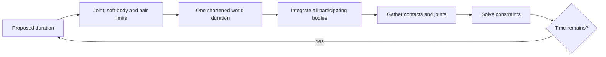

# Milestone 12 Goal 8 — Particle–rigid response

Goal 8 is complete for review and commit. Goal 9 has not started. The immediate parent is `13ac660e`; the frozen reference
remains `physics-pipelines-overoptimized` at
`6f283268aa4bf038c4ed78271baeb9d5986bd7d9`. Exclude `main`. Sources, SDKs,
executables, logs and traces are preserved under
`sandbox/milestone_12/goal_8/` without replacing previous goals' evidence.

## Scope and measurement

Production remains 240 Hz, four configured subdivisions and eight solver
passes. The unchanged 800-particle, diameter-5, restitution-0.5 pit runs to
twelve simulated seconds. The diagnostic one-subdivision/two-particle-pass
variant retains eight passes on mixed contacts. Original correction slop,
correction caps, geometry, materials, masses and all elapsed time are retained.
The pit particle–particle review threshold remains 0.5; Milestone 6 extreme
fixture penetration reviews remain 0.1. Neither threshold is a solver input.
No hard particle–wall pit threshold is introduced.

The diagnostic response wrapper distinguishes circle–circle pairs, rotating
circle pairs, circle–static/held polygon pairs and circle–moving polygon pairs.
Moving includes both simulated dynamic and prescribed kinematic bodies.
The earlier profiler used nonrotation to classify particles, which could
include rotating circle pairs in its mixed category. The measured car prefix
has no rotating circle pairs, so this does not explain its moving-body cost;
the initial inference that it did was incorrect. Historical measurements remain
intact. The unchanged pit has no moving polygon bodies. These timers measure
solver visits, including overlap-only refresh where applicable; a separate
classification probe distinguishes that work from responding contacts.

Nested timers separately measure manifold construction, COM/inertia lookup and
normal, friction and position commits inside mixed response. Their enclosing
exclusive remainder includes offsets, impulse arithmetic, validation, retained
state handling and other response work. Commit timings do not describe the
entire impulse calculation. The reported mixed total includes these children
once; every run's exclusive sum must equal the independently measured root.
Experimental particle-pass dispatch remains outside executed response.

## Implementation

- Reuse an already expanded supporting face as the incident face when the
  reference normal exactly equals its original search axis. Maximizing the
  opposite dot product preserves the minimizing scan's edge and tie order.
  Other normals retain the existing incident-face search. No approximate axis
  match, changed clipping tolerance or persistent geometry cache is added.
- Use compact atomic velocity commits for circle–polygon normal and friction
  impulses, retaining angular response, both-body validation, convergence
  tracking and rejection diagnostics. Normal and friction commits remain
  separate. Here atomic means validate both bodies before writing either; no
  hardware atomics or parallel response are introduced. Position correction
  retains its existing generic transaction.
- Match retained manifold points before calculating rebound targets. Reuse
  matched targets and calculate all new targets before any point changes
  velocity, preserving the incoming state for both points of a manifold.

Face reuse also benefits other callers of the shared polygon manifold helper;
its polygon, concave and soft-contact regressions remain in scope. No public
API, allocation, lifetime, pass count, collision representation or solver order
changes. Standalone stages retain their existing prerequisites and behavior.

The initial baseline shows that manifold construction dominates particle–wall
response. COM lookup is already pose-cached; offset/velocity arithmetic must
remain live between sequential contacts. The existing pose checks and entity
generation checks are retained. SIMD response batches, atomics, circle-versus-
polygon representation changes and GPU migration are not part of this goal.

## Verification

The expanded independent-SDK suite passes all 22 regressions on Linux and under
ASan/UBSan, including manifold,
particle-mode, concave and rigid-stability checks. New mixed-contact cases cover
both entity orders, static/kinematic/dynamic supports, a 40:1 mass ratio, local
COM offsets, friction, angular response and retained one/two-point rebound
targets after another constraint changes velocity.

All 219 Milestone 6 timed scenarios and four state-based particle calibrations
finish on Linux and under ASan/UBSan;
numerical checks pass and state/work traces match the immediate parent. The
frozen-reference comparison also matches after excluding timing and the
previously documented candidate-count change. The soft-body maximum depth is
0.00300585644 units and relative energy error is 0.00136403434. Its worst
Linux delayed update remains 367.545 ms versus the historical 50 ms comparison
budget; that failure remains visible. Passing these numerical checks does not
complete Milestone 6 Goal 5 or the superseded Milestone 11.

Engine and independent measurement-consumer builds pass on Linux, ASan/UBSan
and Windows cross-compilation, without compiler warnings in final build logs.
The independently installed-SDK joints example builds on all three variants
and passes its Linux and sanitizer smoke runs from `/tmp`. Sanitized car and
pit startup/update smokes also pass. Native Windows execution was not performed.

An independent diagnostic compiles the preserved parent manifold implementation
alongside the candidate and compares 32,000 shape-pair results and 160,000
supplied-axis results bit for bit. It includes circles, boxes, concave shapes,
reversed winding, cyclic vertex order, signed zero, oblique and nearly aligned
axes. The differential comparison passes. This is an additional diagnostic;
existing geometric and physical fixtures remain the acceptance evidence.

The initial diagnostic car build lacked the example runtime include directory;
the corrected build is retained with the failed log. The first new static-body
test selected its motion mode before calling velocity setters, which enable
dynamics; the corrected test selects the mode afterward. These test/setup
failures remain evidence, not engine failures hidden by tolerance changes.

Complete rendered acceptance and the car's sixty-second endpoint remain open.
The user-stopped frozen car and interrupted rendered pit trials are preserved.
The interrupted second candidate car prefix is preserved at 472 of 600 updates
and excluded from complete-prefix comparisons. Its replacement finished all
600 updates on AC. The second parent prefix finished with AC disconnected;
its timing is excluded and a replacement completed on AC. The following trial
was refused before execution because AC remained disconnected. All original
results remain in the evidence directory.

## Completed diagnostic comparisons

Three serial AC-powered paired pit profiles at 240 Hz, one subdivision and two
particle passes complete all twelve seconds with identical state/work traces.
The following elapsed milliseconds are exclusive medians over the full run;
the mixed total includes its children once. Independently computed medians
need not sum exactly. CPU totals use the process CPU clock.

| Particle–wall work | Parent ms | Candidate ms |
| --- | ---: | ---: |
| Manifold construction | 1982.007 | 1717.823 |
| COM/inertia lookup | 70.225 | 70.841 |
| Normal velocity commit | 44.937 | 41.427 |
| Friction velocity commit | 22.355 | 20.525 |
| Position commit | 43.979 | 42.979 |
| Remaining response, including offsets and impulse arithmetic | 875.873 | 858.859 |
| Mixed total, including the rows above | 3039.377 | 2752.952 |

Mixed response decreases 9.42%; manifold construction decreases 13.33%.
Total physics CPU median decreases 24505.840 → 24241.447 ms (1.08%), and
p95 update CPU 77.076 → 75.958 ms. The third paired candidate total is slower
than its parent, while mixed response improves in all three pairs. This small
total median change must be read with its run-to-run variability; it is not
rendered-FPS acceptance. Profile overhead and the experimental pass filter are
included. This configuration remains diagnostic, not a new production setting.

The focused response kernel resets incoming velocities between solves, uses a
40:1 mass ratio and off-center COM, and separately measures retained fixed
geometry and position-correcting solves. It is a kernel benchmark, not simulated
playback. Three paired runs preserve identical final state hashes.

| Polygon motion | Fixed geometry, parent → candidate ns/solve | Position correction, parent → candidate ns/solve |
| --- | ---: | ---: |
| Static wall | 382.733 → 326.141 | 879.103 → 829.420 |
| Prescribed kinematic | 372.152 → 321.566 | 895.785 → 829.808 |
| Dynamic, rotating | 454.827 → 372.853 | 1149.420 → 1069.349 |

These reductions are 13.6–18.0% with fixed geometry and 5.7–7.4% with
position correction. They do not establish the same percentage gain for a
complete pit or car update. Full workload timing remains separately reported.

## Final workload comparison and selection

Three serial trials per version use AC power, streaming closed and no concurrent
builds. The table gives median full-run physics CPU and median per-run p95;
positive reduction means lower CPU. The car prefix uses 600 authored updates,
consuming 10.000000521541 simulated seconds, with exact parent/reference state
and work parity under the existing candidate-count comparison rule. It does
not reach the full sixty-second car endpoint.

| Workload | Total CPU, parent → current ms | p95 update CPU, parent → current ms | Total reduction |
| --- | ---: | ---: | ---: |
| Pit, production settings, no extra profiling | 61514.739 → 58904.753 | 122.278 → 117.212 | 4.24% |
| Car, ten-second prefix, instrumented | 105561.547 → 107467.918 | 356.568 → 368.455 | -1.81% |

All three paired unwrapped pit CPU totals improve, although the second pair's
improvement is only 0.39% and its p95 is slightly higher. The median improvement
is 4.24%, with current mean physics cost 81.81 ms per update and p95 117.212 ms.
That mean consumes 4.91 times the entire 16.67 ms frame budget, before rendering.
It is headless physics throughput, not measured rendered FPS.

The car CPU median is 1.81% higher; two of its three paired totals are higher.
Particle–wall inclusive time falls 4285.904 → 4149.926 ms (3.17%), while the
moving-polygon category rises 3602.137 → 3658.569 ms (1.57%). Wall manifold work
falls 1291.791 → 1162.111 ms. These local savings do not establish a car speedup.
The car's current median total implies 179.11 ms of physics CPU per authored
update, with p95 368.455 ms. No rendered acceptance is claimed.

Retain the implementation for its repeatable mixed-contact kernel and pit
savings, exact tested trajectories, and unchanged solver settings. The car's
measured total regression remains visible; broader world-pass reduction belongs
to the next algorithm audit. Do not extrapolate local kernel savings into a
whole-car improvement or tune away penetration failures.

## Penetration and impact checks

Independent pit circle-overlap measurements run after every completed substep.
All configurations finish twelve simulated seconds with zero side escapes.
The two-pass configurations keep eight mixed-contact passes and original
correction settings. They remain diagnostics.

| Tick Hz / configured subdivisions / particle passes | Worst particle overlap | Sampled floor depth | 0.5-unit review |
| --- | ---: | ---: | --- |
| 240 / 4 / 8 | 0.002638297 | 0.002340078 | Pass |
| 240 / 1 / 2 | 0.189830119 | 0.103580713 | Pass |
| 120 / 1 / 2 | 0.556208960 | 0.264598608 | Fail |
| 60 / 1 / 2 | 0.803068857 | 0.420157433 | Fail |

The 120/60 Hz failures remain failures; neither configuration is selected.
The dedicated two-particle 1,000-units/s-each impact completes all five schedules
for both parent and current, at both eight and two particle passes, with exact
paired state/work traces. Worst overlap remains 0.000500202179 units, with no
pass-through or missed response. The Linux and sanitizer regression suites also
cover the production head-on fixture. Placeholder zeros in profiler-only
particle footers are not penetration evidence; the independent oracle supplies
the values above.

## Whole-update algorithm follow-up

The user asks for the underlying algorithmic cause of excessive work, rather
than relying on cumulative local savings. The current control flow confirms a
cross-cutting coupling: `physics_pipeline_update_internal` repeatedly consumes
the remaining duration, and every shortened substep reruns force preparation,
world integration, contact gathering, joint gathering and constraint solving.
The rigid sweep returns one earliest duration across all eligible pairs.
Joint and soft-body stability/sweep limits can shorten it independently.

The default pit performs 108,337,588 nonrotating particle-pair response visits
in twelve seconds. The ten-second car prefix completes 37,113 subdivisions,
compared with 9,600 configured subdivisions before adaptive shortening. These
counts establish repeated work, not how much can safely be eliminated.

The user's specific proposed experiment is to exclude particle–particle
interactions from speed-driven adaptive timestep restrictions, retaining the
particle–rigid and rigid–rigid restrictions. This does not select a new base
tick or configured subdivision count. A useful audit must record which pair
or stability condition actually wins the duration restriction, how much work
it forces elsewhere, and whether particle-pair execution can be scheduled
separately. Removing one source of restrictions alone does not prevent other
contacts from triggering whole-world repetitions.

Any experiment must still meet the 0.5-unit particle overlap review and the
1,000-units/s-per-particle head-on fixture, with no missed response or tunneling.
Swept collision detection and collision-triggered subdivision are distinct;
removing the latter may require a different response method. Contact reuse,
local subdivision of connected bodies and sleeping/wake propagation are
candidates to investigate, not selected designs. Goal 8 changes none of these
scheduling rules. The user approved inserting this audit as the next Goal 9,
before more local optimization. Existing Goals 9–15 become 10–16. Goal 8
verification was briefly paused for the documentation update and then resumed as requested; Goal 9 has
not started.

## Car response classification

A separate complete 600-update prefix uses an extra split by the stored physical
response flag. Its trajectory, duration and work match the paired car runs;
exclusive timing still sums to the independently measured root. This is one
classification diagnostic, not a repeated speed comparison. Physical-response
rows include eligible solver visits even when no impulse is ultimately needed.

| Circle–polygon category | Visits | Inclusive ms |
| --- | ---: | ---: |
| Physical response: static/held polygon | 5,915,864 | 4036.811 |
| Overlap-only: static/held polygon | 0 | 0.000 |
| Physical response: moving polygon | 3,629 | 8.202 |
| Overlap-only: moving polygon | 6,866,172 | 3569.629 |

The moving category is almost entirely overlap-only refresh: 6,866,172 visits
and 3569.629 ms, compared with 3,629 responding visits and 8.202 ms. The previous
moving category therefore overstates physical impulse-response cost. The car
contains no rotating circle pairs. This measured distinction explains the large
category cost alongside very few manifold constructions.

This split prevents treating overlap-only geometry refresh as impulse response.
It also supplies the next audit with a concrete repeated-work category. The
current goal preserves overlap publication and ordering; removing or deferring
that work requires its own behavioral and lifetime verification.

## Evidence and reproduction

`sandbox/milestone_12/goal_8/summary.json` contains audited endpoints, paired
medians, exclusive/inclusive stage times, penetration probes and classification.
`kernel_summary.json` retains the focused kernel comparisons. `run_selection.json`
identifies complete AC trials without overwriting interrupted or battery runs.
`audit.py`, `build.py`, `verify.py`, `example_verify.py`, `resume.py` and diagnostic
sources preserve the procedures. `source_manifest.json` checks compiled source
identity; `final_source_manifest.json`, `changes.patch`, the saved new report
and `manifest.json` preserve final source/artifact provenance. SDKs, binaries,
logs and traces remain under this goal's directory. Profiling wrappers are
confined to diagnostics and are absent from production engine sources.

Review and commit Goal 8 before starting Goal 9. Full rendered car/pit acceptance,
uncapped rendered headroom and final tolerance selection remain Goals 15–16.
